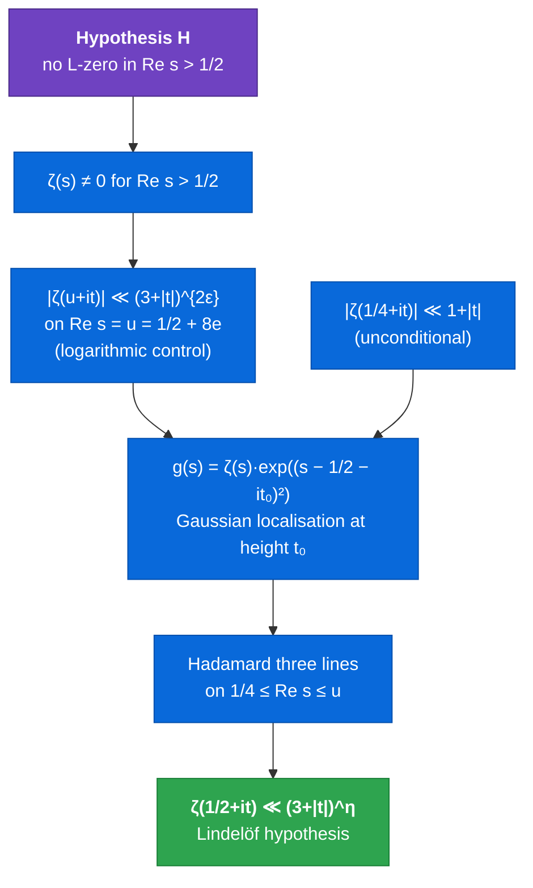

<div align="center">

# 📈 lindelof-rh

### The Lindelöf hypothesis under the Riemann hypothesis

[](lean-toolchain)
[](lake-manifest.json)
[](axioms.txt)
[-d73a49)](LiouvilleEnergyRH/Hypothesis.lean)
[](Axioms.lean)
[](Lindelof.lean)
[](https://github.com/anaxia-research/liouville-energy-rh)

</div>

---

> **Paper.** D. Bhattacharjee and U. Bhattacharya, *The Riemann Hypothesis and Its Generalization as One Energy Bound*, preprint, 2026.
>
> **Parent repository.** [anaxia-research/liouville-energy-rh](https://github.com/anaxia-research/liouville-energy-rh), the full Lean formalization of the paper.



🟣 **Parent conjecture:** the generalized Riemann hypothesis for Dirichlet L-functions, in the form of Hypothesis H: no Dirichlet L-function vanishes in Re s > 1/2. Only its case q = 1, the Riemann hypothesis, is used here.

🎯 **Statement.** For every η > 0 there is K with |ζ(1/2 + it)| ≤ K (3 + |t|)^η for all real t (Lindelöf, 1908; Littlewood, 1912, showed it follows from RH).

🧭 **Proof in one paragraph.** Fix t₀ and multiply ζ by the Gaussian exp((s − 1/2 − it₀)²), whose size is about exp(−(t − t₀)²) on the strip 1/4 ≤ Re s ≤ u. On the left edge Re s = 1/4 the classical bound |ζ| ≪ 1 + |t| gives a bound O(1 + |t₀|). On the right edge Re s = u = 1/2 + 8e the zero-free half-plane and the logarithmic control lemma give |ζ| ≪ (3 + |t|)^{2ε}, so a bound O((3 + |t₀|)^{2ε}). Hadamard's three-lines theorem at s = 1/2 + it₀, where the Gaussian equals 1, interpolates the two with weight 1 − θ ≤ 32e on the left, giving |ζ(1/2 + it₀)| ≪ (3 + |t₀|)^{3(32e + ε)}.

✅ **Lean 4 declarations:**

| Declaration | Statement |
|---|---|
| `LiouvilleEnergyRH.Lindelof.norm_riemannZeta_le_quarter` | ‖ζ(s)‖ ≤ 1/‖s−1‖ + 1 + 4‖s‖ for Re s ≥ 1/4 (unconditional) |
| `LiouvilleEnergyRH.Lindelof.zeta_strip_bound` | ζ ≠ 0 on Re s > 1/2 ⟹ ‖ζ(σ+it)‖ ≤ D (2(3+\|t\|)²)^ε on 1/2+8e ≤ σ ≤ 3/4 |
| `LiouvilleEnergyRH.Lindelof.lindelof` | ζ ≠ 0 on Re s > 1/2 ⟹ ‖ζ(1/2+it)‖ ≤ K (3+\|t\|)^η |
| `LiouvilleEnergyRH.zeta_strip_of_H` | Hypothesis H ⟹ the strip bound |
| `LiouvilleEnergyRH.lindelof_of_H` | Hypothesis H ⟹ the Lindelöf hypothesis |

`lake env lean Axioms.lean` prints only `propext`, `Classical.choice` and `Quot.sound` for each (see `axioms.txt`). There is no `sorry`, `axiom` or `native_decide` in the sources.

## 🔧 Build

```
lake exe cache get
lake build
lake env lean Axioms.lean
```

Lean v4.34.1, Mathlib v4.34.1.

## 🙏 Context and credit

This is one corollary of the paper *The Riemann Hypothesis and Its Generalization as One Energy Bound* by D. Bhattacharjee and U. Bhattacharya. The full formalization is at [anaxia-research/liouville-energy-rh](https://github.com/anaxia-research/liouville-energy-rh). The three-lines theorem is Mathlib's `Complex.HadamardThreeLines`. Hypothesis H is stated word for word as `DirichletLNonvanishingRightOfHalf` in L. Alpöge's Lean project (alpo.ge, November 2026). Third-party sources are listed in [`NOTICE`](NOTICE): the library `Vinogradov/` (creelie/breakthrough-problems-3, Apache 2.0), OpenAI's `LogarithmicControl.lean` (Apache 2.0), and the Selberg sieve from PrimeNumberTheoremAnd (Apache 2.0).

## 📖 Citation

```bibtex
@misc{lindelof-rh,
  author = {Bhattacharjee, Deep and Bhattacharya, Ushashi},
  title  = {lindelof-rh: the Lindel\"of hypothesis under the Riemann hypothesis, in Lean 4},
  year   = {2026},
  url    = {https://github.com/anaxia-research/lindelof-rh}
}
```
